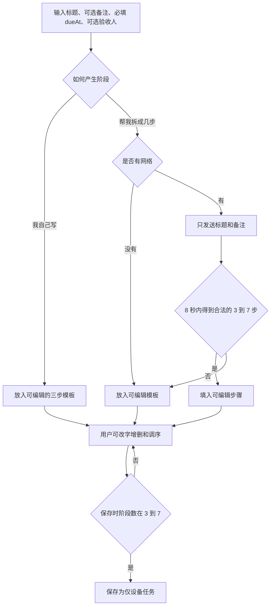
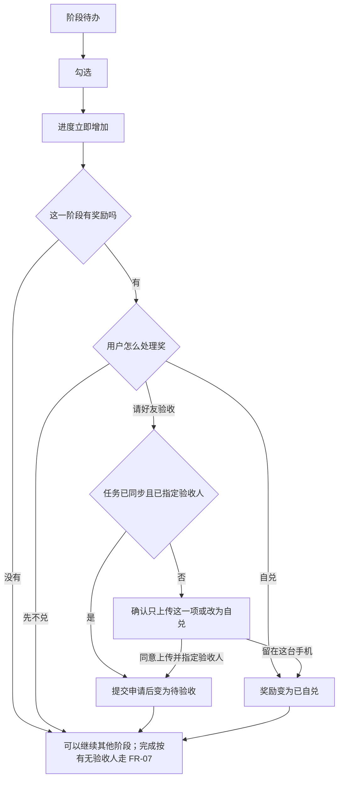
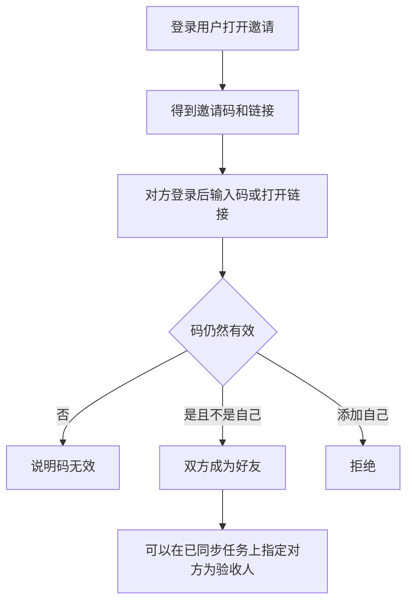
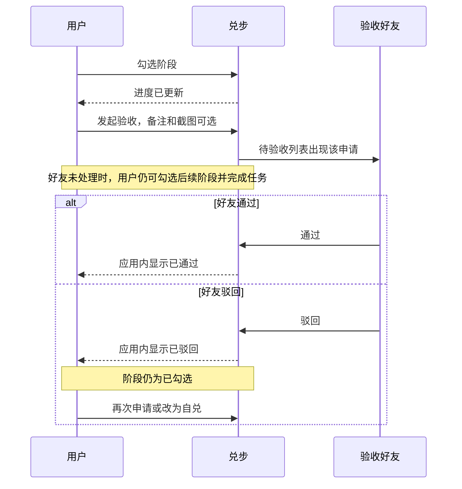
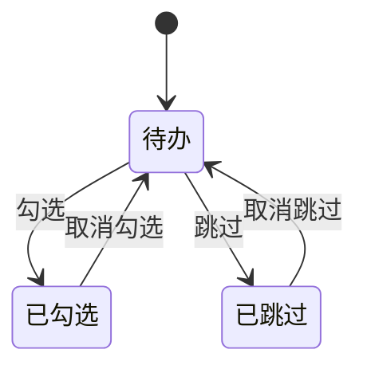
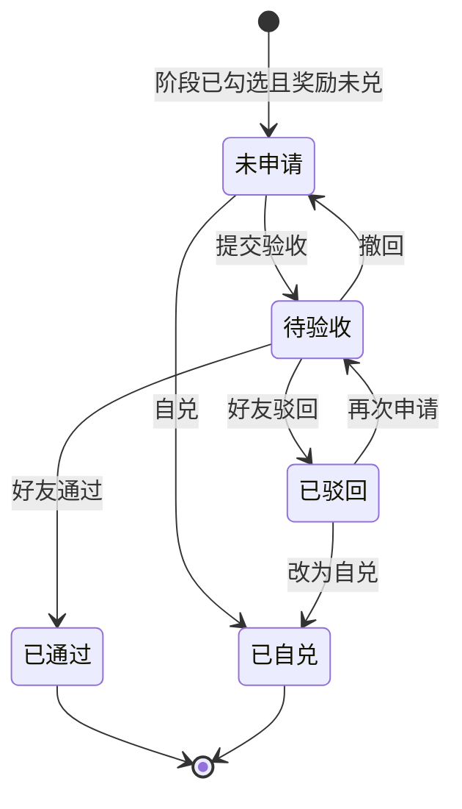
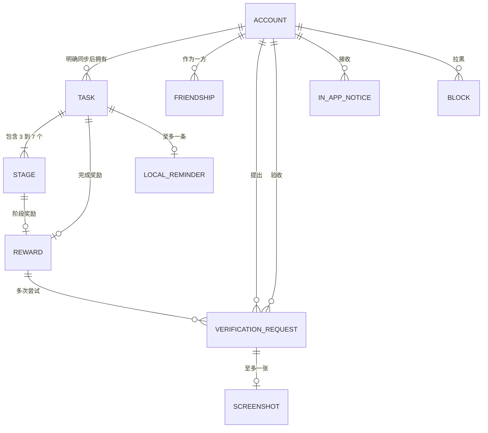

# 兑步产品需求文档（PRD）

工作名：**兑步**；海外显示名：**StepBuddy**。这是一份面向 ADHD 的分步记事本与轻量约定记录产品的需求基线。本文只定义产品行为，不包含应用实现。面向海外首发，**界面默认英语**。

---

## 1. 文档信息

| 项 | 内容 |
| --- | --- |
| 产品工作名 | 兑步（中文）；**StepBuddy**（英文显示名，已定） |
| Bundle ID（拟） | `com.stepbuddy.app`（随英文名调整；**待工程确认**） |
| 文档 | 产品需求文档（PRD） |
| 版本 | **1.1** |
| 状态 | MVP 需求基线（含 2026-11-03 产品变更） |
| 日期 | 2026-11-03 |
| 变更摘要 | v1.1：默认英语 UI；显示名 StepBuddy；阶段可选提醒 + 任务必填截止提醒；可选验收人作任务完成门闩；UI 目标「简约不简单」 |
| 读者 | 产品、设计、iOS 工程、测试 |
| 客户端假设 | 首发为 iPhone 上的 SwiftUI 应用；**默认 locale = English** |
| 奖品假设 | 奖品是文字约定，可选附一条链接；应用不经手付款、不发货 |
| 账号假设 | 好友验收 / 任务完成验收必须登录；自奖可以只留在这台设备上 |
| 仓库范围 | 仅需求文档，不在本仓库实现应用 |

### 1.1 怎么读

- 第 7、9、10、11、12 节是行为基线，测试按其中的验收标准执行。
- 第 13 节约束文案、节奏和界面密度。
- 发版前至少走通第 18 节的三条走查。
- 文中「MVP 决定」是本基线已经选定的做法；「待决」只出现在第 17 节，工程不要自行另选一套。
- v1.1（2026-11-03）起：锁定规则为七条（含可选验收人完成门闩、dueAt/remindAt）；英文显示名 StepBuddy。

### 1.2 名词

| 名词 | 含义 |
| --- | --- |
| 任务 | 用户想做完的一件事。有标题、可选备注、3–7 个阶段、**必填结束时间 `dueAt`**、至多一条完成奖励；可选一名验收人 |
| 阶段 | 任务里的一步。可勾选或跳过。至多一条阶段奖励；可选阶段提醒时间 `remindAt` |
| 勾选 | 用户标记这一步已经做完。勾选立即计入进度 |
| 跳过 | 用户决定这一步先不做。跳过不是失败，也不兑这一步的奖励 |
| 进度 | 已勾选阶段数 / 阶段总数。跳过不增加分子 |
| `dueAt` | 任务结束时间（必填）。到点发本地通知 |
| `remindAt` | 某一阶段的可选提醒时间。到点发本地通知 |
| 阶段奖励 | 挂在某一个阶段上的奖品，该阶段至多一条 |
| 完成奖励 | 挂在整件任务上的奖品，该任务至多一条 |
| 自兑 | 用户自己确认「这个奖我兑了」，只留下记录 |
| 奖励验收 | 已登录好友确认某一条奖品约定成立（不挡阶段勾选） |
| 任务完成验收 | 有验收人时：阶段全无待办且至少 1 步已勾选后，须提交并由验收人通过，任务才变为 `completed` |
| 验收人 | 新建时可选指定的一名好友。有验收人时兼任**任务完成门闩**；奖励兑付仍可按奖励验收结果走 |
| 仅设备任务 | 还没有被用户明确同意上传的任务。未登录时的任务都属此类 |
| 模板 | AI 没能在时限内给出合法步骤时，本地填入的 3 条可编辑阶段 |

### 1.3 已锁定的产品规则

下面七条是基线，后续章节里的流程、状态和验收标准都要满足它们。

1. **阶段进度不等待好友。** 勾选一个阶段，立刻计入进度。好友迟迟不处理**奖励验收**，不得挡住用户继续后面的阶段。**任务是否变为 `completed` 另见第 7 条。**
2. **奖励名额与跳过。** 一个阶段一条奖励；一件任务一条完成奖励。本文件把「一条」执行为上限：可以留空，不能有第二条。跳过阶段不是失败，也不兑该阶段的奖励。
3. **驳回不抹掉完成。** 好友驳回奖励验收或任务完成验收，不得把该阶段退回未完成。用户可以再次申请，或（仅奖励路径）改为自兑。
4. **本地默认；登录后上云。** 未登录时任务只留在本机、只能使用本地自奖。用户登录后，本机仅设备任务自动上传（`POST /v1/tasks` 仍须 `uploadConsent: true`）；已登录时新建任务也会立即尝试自动上传。上传失败不挡登录/创建，任务仍留本机，并可走手动 Upload（S19）兜底。
5. **AI 输入与降级。** 发给 AI 的内容只有任务标题和备注。若 8 秒内得不到合法的 3–7 步，就降级成可编辑模板。
6. **提醒与结果通道。** 每件任务**必填**结束时间 `dueAt`（到点本地通知）；每个阶段**可选**提醒 `remindAt`（到点本地通知）。验收结果在 MVP 里于应用内可见。远程推送放到产品里程碑 v1.1 及以后，不是 MVP 发版阻塞项。
7. **可选验收人作完成门闩。** 新建任务时可指定验收人（可空）。**无验收人**：阶段全无 `pending` 且至少 1 个 `done` 即可自行完成任务。**有验收人**：同样满足阶段条件后须提交**任务完成验收**，验收人通过后任务才 `completed`；奖励兑付仍可另走奖励验收 / 自兑，并可跟验收结果。

### 1.4 规则解读（MVP 已选定）

- 「一条奖励」按**至多一条、允许留空**实现。留空的阶段勾选后只记进度，不出现兑奖动作。
- 进度分母包含已跳过的阶段，避免「全部跳过却显示 100%」。
- **阶段就绪**（可申请完成 / 可自完成）需要：没有仍处于待办的阶段，且至少有 1 个阶段已勾选。全部跳过不能完成任务，也不能领取完成奖励。
- **有验收人**时：阶段就绪后主按钮变为 “Request verification”；通过后才 `completed`。驳回后任务保持进行中（阶段勾选保留），可再次提交。
- **无验收人**时：阶段就绪后可直接 “Complete”。
- 阶段奖励和完成奖励彼此独立。某一阶段的**奖励验收**仍在等待时，不挡继续勾选其他阶段；若任务无验收人，也不挡自行完成任务。有验收人时，任务完成门闩走**任务完成验收**，与单条奖励验收分开记账。
- 验收人默认看不到任务备注。用户若希望对方了解细节，写进这次验收的备注里。
- UI 默认英语；文案与视觉目标是 **simple, not simplistic（简约不简单）**：少装饰、大控件、单一主操作，不堆营销噪点。

---

## 2. 背景与问题

注意力困难常常出现在「把一件事开工并做完」的过程里，而不是出现在愿望本身。事情在脑子里是一整团：步骤边界不清楚，空白的待办列表让人停在标题上；做完一小段之后，正反馈来得太晚；一旦把确认权交给另一个人，对方的作息就会变成自己的进度开关。

现有工具各自卡住一个点：

- 系统提醒事项和普通待办把整件事收成一个复选框，拆步骤要用户自己硬写，写不出来就一直空着。
- 习惯类应用强调连续天数和中断。中断被呈现成失败，和「今天只是跳过一步」不是同一件事。
- 问责、教练或打卡社群把进展绑在对方的回复上。对方忙，这件事就停住。
- 积分、商城和支付把「奖」做成平台商品。用户真正想要的往往是一句私下约定：看一集剧、室友请一杯奶茶、散步到某个路口。

StepBuddy（兑步）要分开三件事：**步骤的进度、奖品的记录、好友确认。** 阶段勾选属于用户，勾选即成立。奖品是一句人话，加上可选链接。好友可以确认奖品约定；若用户主动指定验收人，好友还确认任务是否完成——但好友的时间不参与阶段进度计算。

本产品不提供诊断、治疗、用药建议或心理咨询，也不判断用户有没有「真正做完」。

---

## 3. 目标与非目标

### 3.1 目标

MVP 要让下面几件事稳定成立：

1. 不注册也能把一件任务拆成 3–7 步，勾选，并记下自己的奖（无验收人时可自行完成）。
2. 用户写不出步骤时，可以用 AI；AI 不可用时，仍有一套能改的模板，用户照样能保存。
3. 登录并添加好友之后，可以把某一条奖品交给指定好友做**奖励验收**；新建时也可选验收人，作为**任务完成门闩**。
4. 好友未回复或驳回**奖励验收**时，阶段仍然保持已勾选，用户仍可继续后面的阶段；有验收人时，任务 `completed` 须等任务完成验收通过。
5. 未登录时任务只留本机；登录后自动上传本机仅设备任务；已登录时新建也会自动上云（失败则仍本机 + 手动 Upload）。
6. 提醒由用户显式设置：任务**必填** `dueAt`；阶段**可选** `remindAt`；到点发本地通知。
7. 界面默认英语，显示名为 StepBuddy；视觉与交互简约不简单。

上线后用这些观察方向核对产品有没有跑偏（MVP 不接入第三方行为分析，见第 14 节）：

- 无账号用户能否独立完成「创建 → 勾选 → 自兑」。
- 无验收人时，在仍有奖励待验收申请时自行完成任务的路径是否可用。
- 有验收人时，阶段就绪 → 提交任务完成验收 → 通过后才 `completed` 的路径是否可用。
- AI 超时或返回不合法时，用户是否仍能保存任务。

### 3.2 非目标（MVP 明确不做）

- 甘特图、项目树、子任务的子任务、多层级大纲。
- 治疗师式对话、教练聊天、情绪辅导、诊断问卷。
- 支付、电商、积分、虚拟货币、奖品商城、平台代发奖品。
- 动态信息流、陌生人匹配、公开主页、排行榜。
- 视频监考、实时摄像头、AI 自动判断用户是否说了真话。
- 复杂习惯算法：连续天数惩罚、自适应难度、自动加码、智能催促序列。
- 远程推送（放到 v1.1，不阻塞 MVP）。
- Android、Web 客户端、iPad 专属布局（iPad 放到 v1.2）。

### 3.3 成功时用户能感到的差别

用户能感到：这一步已经算数了；奖是我自己写的；朋友可以帮我作个见证，但朋友不在线时我还是能往下做。

---

## 4. 用户画像与场景

画像是设计用的具体人，不是临床分类。产品不要求用户证明自己是否患有 ADHD，也不采集诊断信息。

### 4.1 林可：先在这台手机里用起来

22 岁，学生。作业和杂事经常停在「太大，不知从哪开头」。她不想先注册。她希望打开就能写一个标题，看到几步能改的小步骤，做完一步就勾上，并写上「看一集剧」。没有网络时也要能勾、能记奖。

### 4.2 周屿：和室友有一句私下约定

28 岁，在职。周报、搬家清单这类事想拆开。奖品是「写完请室友确认后，室友请一杯奶茶」。奶茶在线下发生，应用只记录这句约定和他的确认。室友如果当晚没看手机，周屿需要继续写完剩下的部分。

### 4.3 陈麦：偶尔点一下的验收人

周屿的室友。不愿意当教练，也不想读长备注和聊天。打开应用应能看到：谁、哪一步、什么奖、一句可选说明、一张可选截图，然后通过或驳回。驳回不必写文章。

### 4.4 关键场景

| 编号 | 场景 | 期望 |
| --- | --- | --- |
| SC-1 | 面对空白步骤写不出来 | 可请 AI 拆；8 秒内不成功则出现可编辑模板，并能保存 |
| SC-2 | 好友睡着了或在忙 | 已勾选的进度保持；可继续勾后面阶段；无验收人可自完成；有验收人则完成须等对方处理任务完成验收 |
| SC-3 | 好友认为证据不够而驳回 | 该阶段仍是已勾选；可以再申请，或改成自兑 |
| SC-4 | 飞机上、地铁、未登录 | 创建（含 dueAt）、编辑、勾选、跳过、自兑、已登记的 dueAt/remindAt 本地通知都可用 |
| SC-5 | 登录后手机里已有旧任务 | 登录后自动上传这些仅设备任务（`uploadConsent: true`）；失败则该项仍仅设备，可用手动 Upload（S19） |
| SC-6 | 某一步决定不做了 | 可以跳过；界面不称其为失败；该步奖励不能兑 |
| SC-7 | 只想记事，不想设奖 | 奖励留空；勾选只推动进度 |

---

## 5. 价值主张与差异化

**一句话：** 把事情拆成能走完的几步，把奖兑在步上；朋友可以见证约定与（可选的）任务完成，但不卡住你逐步勾选。

| 对照 | 他们通常怎么做 | 兑步怎么做 |
| --- | --- | --- |
| 普通待办 | 一个大事复选框，拆解靠自己 | 固定 3–7 步，AI 或模板帮你起头，步始终可改 |
| 习惯打卡 | 连续天数，中断像失败 | 跳过是中性状态；没有连续天数，没有中断惩罚 |
| 问责 / 教练产品 | 进度常等于对方已读或已回复 | 勾选即阶段进度；奖励验收不挡勾选；仅当用户主动指定验收人时，任务完成才走验收门闩 |
| 奖励商城 | 平台定价、积分、支付 | 奖品由用户自己写，链接只是外链记录 |

差异化要守住两条边界：不把兑步说成治疗；不把好友说成监工。验收文案使用「确认这条约定」，不使用「证明你没有撒谎」这类说法。

---

## 6. 信息架构与界面清单

### 6.1 结构

底部三个标签，控制选择数量：

1. **任务**：列表和任务详情。
2. **待验收**：别人请我处理的申请，以及我发出的申请结果。未登录时说明「登录后才能请好友验收」，并提供登录入口。
3. **我的**：好友、邀请、账号、提醒权限说明、隐私与关于。

创建、编辑、自兑、发起验收用从任务进入的页面完成，不另做标签。

未登录时「任务」和本地自奖完整可用。「待验收」与好友相关动作引导登录，不隐藏已经存在的本地任务。

### 6.2 任务详情上的信息顺序

一屏从上到下：

1. 标题。
2. 进度，例如「2/5 checked · 1 skipped」（默认英语）。
3. **Due：** 必填的任务结束时间 `dueAt`，可改；到点本地通知。
4. 验收人（若有）：显示昵称；无则不占主视觉。
5. 阶段列表。每一行有：大号勾选控件、阶段标题、可选阶段提醒摘要、奖励摘要、「Skip for now」。
6. 完成奖励卡片。任务尚未满足完成条件时，卡片说明还差什么，但不禁用用户先把奖品文字写好。
7. 主按钮只有一个语境：还有待办时指向列表中的下一步（滚动到该行）；阶段就绪且**无验收人**时为「Complete」；阶段就绪且**有验收人**时为「Request verification」；任务完成验收待处理时为等待态（可撤回）。

勾选发生在列表里，不进入二级页才算勾上。

### 6.3 界面清单

| ID | 界面 | 入口 | 目的 | 版本 |
| --- | --- | --- | --- | --- |
| S01 | 任务列表 | 任务标签 | 看到进行中与已完成；新建 | MVP |
| S02 | 任务详情 | 列表中的一项 | 勾选、跳过、看进度与奖励 | MVP |
| S03 | 编辑任务 | 新建或详情中的编辑 | 改标题、备注、**必填 dueAt**、可选验收人 | MVP |
| S04 | 编辑阶段 | 详情或新建流程 | 改字、上下移动、增删、**可选 remindAt**；保存时必须是 3–7 步 | MVP |
| S05 | AI 拆解 | 新建时选择「帮我拆成几步」 | 等待最多 8 秒，得到可编辑步骤或模板 | MVP |
| S06 | 编辑奖励 | 阶段行或完成奖励 | 奖品文字、可选链接；留空表示不设奖 | MVP |
| S07 | 自兑确认 | 已勾选且有奖励 | 记下「已自兑」 | MVP |
| S08 | 发起奖励验收 | 已勾选且有奖励，并已指定验收人 | 可选备注、可选一张截图，发送奖励验收 | MVP |
| S08b | 发起任务完成验收 | 阶段就绪且任务有验收人 | 可选备注、可选一张截图；通过后任务才 completed | MVP |
| S09 | 验收申请详情 | 任务详情或待验收 | 查看状态、历史结论；待验收时可撤回（含奖励 / 任务完成两类） | MVP |
| S10 | 待我验收列表 | 待验收标签 | 处理别人发来的申请（奖励或任务完成） | MVP |
| S11 | 处理验收 | 待我验收中的一项 | 看上下文，通过或驳回 | MVP |
| S12 | 我的申请结果 | 待验收标签内分段 | 在应用内看到通过、驳回 | MVP |
| S13 | 好友列表 | 我的 | 已添加的好友；移除；拉黑 | MVP |
| S14 | 邀请好友 | 我的 | 展示邀请码与分享链接 | MVP |
| S15 | 输入邀请码 | 我的或链接 | 用码成为好友 | MVP |
| S16 | 任务截止时间 | 新建 / 任务详情 | 设定或修改必填 `dueAt`（本地通知） | MVP |
| S16b | 阶段提醒 | 阶段行 / 编辑阶段 | 为该阶段设定、修改或清除可选 `remindAt` | MVP |
| S17 | 登录 | 我的、待验收、或需要验收时 | 使用 Sign in with Apple | MVP |
| S18 | 设置与隐私 | 我的 | 本地数据说明、医疗边界、协议、删号 | MVP |
| S19 | 上传此项确认（手动兜底） | 自动上传失败后、或用户对仍为仅设备的任务手动点 Upload 时 | 明确只上传这一项；请求体仍带 `uploadConsent: true` | MVP |
| S20 | 离线与空状态 | 各相关界面 | 说明现在能做什么 | MVP |
| S21 | 举报 | 验收详情 | 举报备注或截图 | MVP |
| S22 | 不同验收人 | 单条奖励 | 这一条奖指定另一位好友 | v1.1 |
| S23 | 推送设置 | 设置 | 远程通知开关 | v1.1 |

### 6.4 新建任务的步骤

1. 输入标题（必填）。备注可选。
2. 设定**任务结束时间 `dueAt`（必填）**。
3. 选择「Help me break it down」或「I'll write the steps」（默认英语文案）。
4. 得到 3–7 条可编辑阶段。自己写时，初始放入与模板相同的 3 条，避免空白页。每一阶段可**可选**填 `remindAt`。
5. **验收人**可选：须已登录才能从好友中选一名；未登录或不选则无验收人（可自行完成）。创建时已指定的验收人在后续 Request verification / Upload 中只展示、不重选。已登录保存时会立即自动上云；若仍为仅设备（如上云失败），手动 Upload 走 S19。
6. 奖励可以稍后再写。新建流程不强制填奖。
7. 保存后进入任务详情。

未登录时默认只保存在这台设备。已登录时新建先落本机并立即自动上云（`uploadConsent: true`）；失败则保持仅设备，可用手动 Upload（S19）兜底。不再提供「Save to account」开关。

### 6.4.1 语言与命名

- **默认界面语言：English**（面向海外）。本 PRD 正文可用中文描述行为；产品字符串以英语为源语言。
- **显示名：StepBuddy**。中文工作名「兑步」可保留在内部文档。
- **Bundle ID 拟为 `com.stepbuddy.app`**，随显示名调整；最终以工程 / Apple Developer 配置为准（待确认）。

### 6.5 空状态与 UI 方向

- 任务列表为空（英语源文案）：“Write something you want to move forward.” 主按钮 “New task”。
- 不写 “You don’t have any achievements yet” 或连续天数。
- **UI 目标：简约不简单（simple, not simplistic）**——少层级、大触控、单一主操作、克制装饰；不为「好看」堆卡片与渐变。

---

## 7. 功能需求（P0 / P1 / P2 + 验收标准）

优先级：

- **P0**：MVP 发版必须满足。
- **P1**：v1.1。
- **P2**：v1.2 及以后。

通用字段限制（全优先级适用）：

| 对象 | 限制 |
| --- | --- |
| 任务标题 | 1–40 字，必填 |
| 任务备注 | 0–500 字 |
| 任务 `dueAt` | 必填；本地日期时间；不得早于创建当下（保存时校验，允许等于「现在」后的最近可选刻度） |
| 阶段标题 | 1–40 字 |
| 阶段 `remindAt` | 可选；本地日期时间；若填写，建议不晚于任务 `dueAt`（超出时给出提示，MVP 可硬校验为 ≤ dueAt） |
| 奖品文字 | 0–80 字；有奖励时至少 1 字 |
| 奖品链接 | 可选；仅 `http` 或 `https`；最长 500 字符 |
| 验收备注 | 0–200 字 |
| 驳回说明 | 0–80 字 |
| 昵称 | 1–20 字 |
| 截图 | 每条申请至多 1 张 |

链接在 MVP 只展示并可交给系统浏览器打开。应用不预取链接内容。

### 7.1 P0 任务、阶段与进度

#### FR-01 创建任务（P0）

用户可以凭标题与**必填结束时间 `dueAt`** 创建任务；备注可空；验收人可选；奖励可不填。创建过程不要求登录、不要求网络（指定验收人则需已登录好友，见 FR-16）。

验收标准：

- 标题空白或只有空格时不能保存，并指出要写标题。
- 未设置 `dueAt` 时不能保存，并指出需要结束时间。
- 未选验收人时仍可保存；保存后无验收人，阶段就绪后可自行完成。
- 有合法标题时，无网络、未登录都可以保存。
- 未登录保存后的新任务为仅设备任务。
- 已登录用户新建时：先落本机并立即自动上云（`uploadConsent: true`）；上云失败则仍为仅设备，可用手动 Upload（S19）兜底。不再提供「保存到账号」开关。

#### FR-02 阶段数量（P0）

每件任务在保存后始终有 3–7 个阶段。来源可以是手写、AI 或模板。用户可以改标题。

验收标准：

- 保存后的任务阶段数落在 3–7。
- 阶段标题不能为空。
- 编辑过程中可以暂时变成 2 条或 8 条，保存按钮不可用，并说明需要 3–7 步。
- 少于 3 条时提示「至少留 3 步，可以改写成很小的一步」。
- 达到 7 条后再添加时提示「最多 7 步。要再拆，先改掉或删掉现有的一步」。

#### FR-03 调整阶段（P0）

用户可以改标题、上移、下移、删除、新增。MVP 用上移/下移，不用手势拖拽作为唯一方式。

验收标准：

- 上移/下移后顺序在离开页面再进入时仍然保持。
- 删除已填写奖励或已勾选的阶段前，有一次确认。
- 删除后少于 3 步时不能保存。
- 手势拖拽不是 MVP 验收项。

#### FR-04 勾选立即计入进度（P0）

勾选不需要二次确认。进度在同一次操作中更新，不等待网络，也不等待好友。

进度定义：`已勾选阶段数 / 阶段总数`。另以中性文字显示跳过数，例如「2/5 已勾选 · 跳过 1」。跳过不计入分子。

验收标准：

- 勾选后立即看到分子增加，包括飞行模式。
- 有待验收申请时再勾选其他阶段，分子仍然增加。
- 进度不因好友通过才增加，也不因好友驳回而减少。
- 勾选控件在阶段行上，不依赖会消失的提示条才能完成。

#### FR-05 取消勾选（P0）

误触需要能收回，但不能破坏已经发生的兑奖。

验收标准：

- 该阶段奖励仍是「未申请」、或该阶段没有奖励时，可以取消勾选，分子随之减少。
- 奖励处于待验收、已通过、已驳回、已自兑时，不能取消勾选。
- 已驳回时阶段保持已勾选。

#### FR-06 跳过（P0）

待办阶段可以「先跳过」。跳过前有一次说明：「跳过不会算失败，这一步的奖也不能兑。之后可以取消跳过。」只有一次确认。

验收标准：

- 跳过后进度分子不变，跳过计数增加。
- 界面不出现「失败」「未完成惩罚」「中断」作为该状态的名称。
- 跳过的阶段不能自兑，也不能发起验收。
- 可以从已跳过回到待办；回到待办不改变已勾选数。
- 已勾选的阶段不能直接改成跳过。要先在 FR-05 允许的条件下取消勾选，再跳过。

#### FR-07 完成任务（P0）

**阶段就绪**定义：每个阶段都是已勾选或已跳过，且至少 1 个阶段已勾选。

- **无验收人：** 阶段就绪后，用户可直接将任务标为 `completed`。此时不读取任何**奖励**验收状态。
- **有验收人：** 阶段就绪后，用户须发起**任务完成验收**（S08b）；仅当验收人通过后，任务变为 `completed`。驳回或撤回后任务保持进行中，可再次提交。阶段勾选不被驳回抹掉。

验收标准：

- 存在待办阶段时，不能完成任务，也不能提交任务完成验收。
- 全部为跳过时，不能完成任务，也不能领取完成奖励。
- **无验收人**时：存在待验收、已驳回或未兑的阶段奖励，仍然可以自行完成任务。
- **有验收人**时：主按钮在阶段就绪后为「Request verification」，不是直接 Complete；通过前 `status` 仍为 `active`。
- 任务完成验收通过后：`status = completed`，记下 `completedAt`；阶段勾选状态保持原样。
- 完成奖励在任务 `completed` 之后才可以自兑或申请奖励验收；完成前可以先写好奖品文字。
- 任务变为 `completed` 或用户删除任务时，取消该任务尚未触发的 `dueAt` 与各阶段 `remindAt` 本地通知。

### 7.2 P0 奖励与自兑

#### FR-08 奖励名额（P0）

每个阶段至多一条阶段奖励。每件任务至多一条完成奖励。

验收标准：

- 已有一条阶段奖励时，不能再为该阶段添加第二条，只能编辑或清空。
- 已有完成奖励时同样不能添加第二条。
- 清空奖励后，该槽位回到「无奖励」。
- 无奖励的阶段勾选后不出现自兑或验收入口。

#### FR-09 奖品内容（P0）

奖品由用户填写文字，可选一条链接。应用把它们存成约定记录。

验收标准：

- 只填文字可以保存。
- 链接不是 `http`/`https` 时不能保存，并说明只支持网页链接。
- 界面有一句固定说明：「这是你们的约定记录，兑步不经手奖品。」
- 全产品没有支付、下单、余额、积分或收货地址界面。

#### FR-10 自兑（P0）

阶段已勾选且该阶段有奖励时，用户可以自兑。任务已完成且有完成奖励时，用户可以自兑完成奖励。自兑不需要登录，不需要网络。

验收标准：

- 自兑确认后，该奖励变为已自兑，并记下时间。
- 已自兑的奖励不能再次自兑，也不能再发起验收。
- 飞行模式、未登录下自兑成功，重新打开应用后记录仍在。
- 跳过的阶段没有自兑入口。

#### FR-11 跳过不兑该阶段奖励（P0）

验收标准：

- 阶段在跳过前即使写了奖品文字，跳过之后自兑和验收入口都不可用。
- 取消跳过并在之后勾选，该奖励才可以兑。
- 跳过不影响完成奖励槽位里已经写好的文字。

### 7.3 P0 登录、本地与上传

#### FR-12 未登录只有本地自奖（P0）

未登录用户可以使用创建、编辑、勾选、跳过、进度、自兑、必填 `dueAt`、可选阶段 `remindAt`。不可以使用好友、指定验收人、发起奖励/任务完成验收、处理验收。未登录创建的任务无验收人，阶段就绪后可自行完成。

验收标准：

- 未登录进入好友或验收动作时，说明需要登录，并可以前往登录。
- 选择登录不会清空现有仅设备任务；登录成功后会自动尝试上传这些任务（失败不挡登录）。
- 未登录时任务数据在应用重启后仍在本机。

#### FR-13 登录后自动上传仅设备任务（P0）

登录成功后，应用对本机全部 `device_only` 任务做 best-effort 自动上传；每次 `POST /v1/tasks` 仍须 `uploadConsent: true`。单条或全部失败不得使登录失败；失败项保持仅设备，用户可在任务详情用手动 Upload（S19）重试。

验收标准：

- 登录成功后，原先仅设备任务应被尝试上传；成功者变为已同步，失败者仍为仅设备且登录仍成功。
- 登录流程不因上传失败而回滚会话。
- 账号里已有的、用户以前已同步过的任务可以在登录后下载；与自动上传本机旧任务并行、互不替代。

#### FR-14 上传同意与手动 Upload（S19）（P0）

自动上传路径（登录批传、已登录新建）在请求体携带 `uploadConsent: true`，不再弹出「Save to account」。仅当任务仍为仅设备时，用户可打开 S19 手动 Upload：确认文案说明只会上传这一项的标题、备注、阶段和奖品文字。用户取消时，任务保持仅设备；若用户是为了验收而来，则留在自兑路径。

会打开 S19 的动作：任务详情「Upload this task」（自动上云失败后的兜底）。创建时已指定验收人则 S19 只展示验收人、不重选。

验收标准：

- 取消 S19 后，该任务仍为仅设备，其他任务也未被上传。
- 同意后，只有这一项成为已同步任务；请求含 `uploadConsent: true`。
- 验收人侧接口不返回任务备注，只返回：申请人昵称、任务标题、阶段标题或「整个任务完成」、奖品文字、奖品链接、本次验收备注、本次截图。
- 截图只在用户于某一次申请里附上并发送时上传，不随任务 Upload 批量上传。

### 7.4 P0 好友与验收

#### FR-15 用邀请码或链接加好友（P0）

每位登录用户有一个邀请码。邀请链接携带同一枚码。对方登录后输入码或打开链接，双方成为好友。分享邀请码视为邀请方同意持有该码的人添加自己。不需要邀请方第二次点同意，以免空等。

MVP 决定：

- 邀请码可重置。重置后旧码和旧链接立即失效。
- 不能添加自己。
- 已经是好友时再次使用码，保持好友关系并提示已经是好友。
- 同一账号连续多次使用错误码时，暂时停止尝试（具体阈值由工程取「每小时 10 次错误」作为起步，需能配置）。
- 不做陌生人推荐。

验收标准：

- 有效码可以建立好友，双方列表都能看到对方昵称。
- 重置后旧码不能再加好友。
- 未登录不能生成邀请码。
- 产品内没有「附近的人」「推荐好友」或公开动态。

#### FR-16 指定验收人（P0）

每件任务至多一名验收人，人选必须是当前好友；可在**新建时可选指定**，也可在已同步任务上稍后指定或更换。MVP 中该验收人同时用于：

1. **任务完成门闩**（有验收人时，见 FR-07 / FR-17b）；
2. **阶段奖励与完成奖励的奖励验收**（与既有奖励验收共用此人）。

无验收人 = 可自行完成任务；有验收人 ≠ 自动要求每条奖励都走验收（奖励仍可选自兑或申请验收）。

验收标准：

- 未同步任务进入指定验收人时先走 FR-14。
- 没有好友时，引导去邀请，不能指定一个非好友。
- 新建未选验收人合法；之后补指定验收人，若任务已阶段就绪且尚未 `completed`，则完成路径切换为须走任务完成验收。
- 更换验收人只影响之后新提交的申请；已经待验收的申请仍由原验收人处理。
- 移除好友后，不能再向其提交新申请；已通过的历史记录保留；待验收申请（奖励或任务完成）按撤回处理；奖励回到未申请；阶段仍保持已勾选；若因此任务不再有可用验收人，完成路径回退为可自行完成（产品需在界面说明）。

#### FR-17 发起奖励验收（P0）

阶段已勾选且有奖励、任务已指定验收人、用户已登录且该任务已同步时，可以发起**奖励验收**。备注可选，截图可选且最多一张。完成奖励在任务 `completed` 后按同样规则发起。

发送时把该申请所需材料交给验收人。没有网络时不建立「待发出队列」。界面说明现在发不出去，可以先自兑，或恢复网络后再请好友。用户已填写的备注和已选图片保留在当前表单上。

截图在上传前去掉位置等元数据，长边压到不超过 1600 像素，压缩后不超过 4MB。做不到时不允许发送这张图，并允许改发不带图的申请。

验收标准：

- 不填备注、不附截图也可以发送。
- 发送成功后奖励变为待验收，阶段保持已勾选，进度不变。
- 同一奖励已有待验收申请时，不能并行发第二条。
- 飞行模式下发送失败，阶段仍是已勾选，表单内容还在。
- 跳过的阶段不能发送奖励验收。
- 验收人打开申请时看不到任务备注，除非申请人把内容写进了验收备注。

#### FR-17b 发起任务完成验收（P0）

任务已指定验收人、已登录、已同步，且阶段已就绪（见 FR-07）时，用户可发起**任务完成验收**。备注与截图规则同 FR-17。通过后任务 `completed`；驳回或撤回后任务保持 `active`，阶段进度不变。

验收标准：

- 阶段未就绪时不能发起。
- 同一任务同时最多一条待处理的任务完成验收申请。
- 通过后 `status = completed`；完成奖励此时才可兑。
- 驳回不把任何阶段改回待办；可再次申请。
- 奖励验收的待处理状态不自动产生或关闭任务完成验收。

#### FR-18 通过与驳回（P0）

验收人可以在 S11 通过或驳回（奖励验收或任务完成验收）。驳回说明选填。奖励验收通过表示「确认这条约定」，不表示平台已发放奖品。任务完成验收通过表示同意任务完成。

验收标准：

- **奖励验收**通过后该申请为已通过，奖励为已通过，记下处理时间。
- **任务完成验收**通过后该申请为已通过，任务 `completed`，记下 `completedAt`。
- 驳回后：奖励路径下奖励为已驳回；任务完成路径下任务仍为 `active`。阶段进度状态仍是已勾选，分子不减少。
- 验收人看不到自兑按钮，不能改申请人的阶段。
- 处理完成后，申请人在 S12 能看到结果。MVP 不依赖远程推送。

#### FR-19 驳回之后的选择（P0）

奖励处于已驳回时，用户可以再次申请，或改为自兑。

验收标准：

- 再次申请生成一条新的申请，旧的驳回记录仍可查看。
- 再次申请可以更换备注和截图。
- 改为自兑后奖励变为已自兑，不能再就同一奖励继续申请。
- 两条路径都不会把阶段改回待办。

#### FR-20 奖励待验收不阻塞阶段进度（P0）

**奖励验收**状态不参与「能不能勾选下一步」。任务是否可 `completed` 只按 FR-07（有无验收人 / 任务完成验收是否通过）。

验收标准：

- 奖励为待验收时，其他待办阶段仍可勾选或跳过。
- **无验收人**且阶段就绪时，即使存在待验收或已驳回的阶段奖励，自行完成仍可用。
- **有验收人**时：完成取决于任务完成验收，不取决于各条奖励是否已兑完。
- 将任务标为 `completed`（自行或经任务完成验收通过）不自动把进行中的奖励待验收改成通过或驳回。

#### FR-21 撤回待验收（P0）

用户可以撤回仍在待验收的申请（奖励验收或任务完成验收）。

- **奖励验收**撤回后：奖励回到未申请，阶段保持已勾选；之后可以自兑或重新申请。
- **任务完成验收**撤回后：任务保持 `active`，阶段进度不变；之后可再次提交任务完成验收。

验收标准：

- 撤回后再打开详情，对应申请不再为 pending；进度不变。
- 验收人的待处理列表不再出现该申请。
- 已通过或（奖励路径）已自兑不能撤回。

### 7.5 P0 AI 拆解

详细约定见第 11 节。这里规定功能级验收。

#### FR-22 AI 只接收标题和备注（P0）

用户选择「帮我拆成几步」时，发给模型的业务内容只有任务标题和备注。

验收标准：

- 请求中不包含奖品文字、链接、好友昵称、账号标识、历史任务、截图、位置、诊断或任何其他任务正文。
- 备注为空时仍可请求，只发送标题。
- 用户可在隐私说明里读到上述范围。

#### FR-23 八秒降级为可编辑模板（P0）

从发出请求起 8 秒内，若没有拿到合法的 3–7 步，就填入第 11 节的模板。超时、断网、无法解析、步数不在 3–7、存在空标题，都算没有拿到。

验收标准：

- 超过 8 秒不再继续等待，界面进入可编辑模板。
- 8 秒后才到达的结果被丢弃，不覆盖用户已经看到的模板。
- 降级不用错误弹窗挡住编辑。可以有一行说明：「这次没能拆开，下面是可以改的三步。」
- 模板标题都可改，并且可以增删到 3–7 步后保存。
- 没有网络时不发起请求，直接使用同一套模板。

#### FR-24 拆解结果可编辑（P0）

AI 返回的步骤在保存前全部可改，不自动锁定。

验收标准：

- 用户改过标题后再保存，保存的是改后的文字。
- 用户可以删掉 AI 步骤并改成自己的 3–7 步。

### 7.6 P0 通知

详细策略见第 12 节。

#### FR-25 任务截止与阶段可选提醒（P0）

- 每件任务**必填**一个结束时间 `dueAt`。修改 `dueAt` 即替换原截止通知。
- 每个阶段**可选**一个提醒时间 `remindAt`。可清除；清除后该阶段不再提醒。
- 到点由系统发**本地通知**。不设置重复周期。
- 任务变为 `completed` 或用户删除任务时，取消该任务尚未触发的 `dueAt` 与各阶段 `remindAt`。
- 文案温和，默认英语，例如 `StepBuddy: {task title}`（截止）或 `StepBuddy: {stage title}`（阶段）；不含责备句。

验收标准：

- 保存任务时若无 `dueAt`，不能保存。
- 同一阶段至多一个 `remindAt`；更新即替换。
- 拒绝通知权限时，任务的其他能力保持可用，并说明如何在系统设置里打开。
- 权限请求发生在用户第一次设置 `dueAt` 或 `remindAt` 时，不在首次启动时弹出。
- 已登记的本地通知在飞行模式下到点仍触发。
- MVP 没有「智能提醒」或自动催促序列。本条取代原「每任务仅一条本地提醒」。

#### FR-26 验收结果在应用内可见（P0）

通过、驳回和撤回的可见性以应用内列表为准。用户打开「待验收」里的结果分段，或打开对应任务，就能看到当前状态。

验收标准：

- 验收人处理之后，申请人下次打开应用并进入结果或任务详情时能看到新状态。
- 看不到远程推送时，上述路径仍然成立。
- MVP 设置里没有「开启远程推送」开关。

### 7.7 P0 关系安全与声明

#### FR-27 移除、拉黑与举报（P0）

用户可以移除好友，也可以拉黑。拉黑后双方不能再发新的验收。用户可以举报某一条验收里的备注或截图，选择原因并可选补充说明。举报进入人工处理队列。

MVP 不做公开内容推荐，因此不做信息流过滤算法。

验收标准：

- 拉黑后发起验收时不能再选中该用户。
- 举报提交后，举报人看到「已收到」。
- 举报不改变阶段的勾选状态。

#### FR-28 非医疗声明（P0）

首次进入能看到一句：「兑步是记事和约定记录工具，不是医疗或治疗服务。」设置里可以再读完整说明。

验收标准：

- 首次启动能看到这句话，并且可以进入任务列表。
- 产品界面不出现诊断、治疗、用药或「治疗 ADHD」的承诺。

### 7.8 P1（v1.1）

#### FR-29 验收结果远程推送（P1）

在系统通知权限允许时，用远程推送告知申请人：某条验收已通过或已驳回。推送失败或用户关闭推送时，FR-26 的应用内路径仍然可用。远程推送不是 MVP 发版条件。

验收标准：

- 关闭推送权限后，应用内仍能看到通过或驳回。
- 推送正文不含任务备注和截图。
- MVP 版本不因缺少推送而阻断发版。

#### FR-30 按奖励指定验收人（P1）

在任务级验收人之外，允许某一条阶段奖励或完成奖励指定另一位好友。

验收标准：

- 未单独指定的奖励仍使用任务级验收人。
- 单独指定只影响该奖励之后的新申请。

#### FR-31 多设备下的已同步任务（P1）

已同步任务可在第二台已登录设备上编辑。MVP 只保证单设备为主；若 v1.1 允许多设备，冲突策略采用最后写入覆盖，并在设置中说明。仅设备任务不同步到第二台。

### 7.9 P2（v1.2）

#### FR-32 主屏幕小组件（P2）

小组件只显示一件进行中任务的标题和下一个待办阶段，点击进入该任务。不在小组件里兑奖。

#### FR-33 导出（P2）

把选定任务导出为纯文本：标题、阶段及勾选/跳过、奖品文字与兑奖状态。导出由用户主动触发。

#### FR-34 iPad 布局（P2）

在保持同一信息结构的前提下适配大屏。不增加项目树。

#### FR-35 复制为新任务（P2）

用户可以把一件任务复制成一件新的未开始任务（阶段标题和奖品文字复制，进度和验收记录不复制）。这是手工复制，不是习惯调度引擎，不自动按日生成。

### 7.10 锁定规则与需求对照

| 锁定规则 | 需求 |
| --- | --- |
| 勾选立即计入阶段进度；奖励验收不挡继续勾选 | FR-04、FR-20 |
| 无验收人可自完成；有验收人须任务完成验收通过才 completed | FR-07、FR-16、FR-17b、FR-18 |
| 一阶段一奖励；一任务一完成奖励；跳过不是失败且不兑该阶段奖励 | FR-06、FR-08、FR-11 |
| 驳回不退回未完成；奖励路径可再申请或改自兑 | FR-05、FR-18、FR-19 |
| 未登录仅本地自奖；登录后自动上传仅设备任务；已登录新建亦自动上云；失败走 S19 | FR-12、FR-13、FR-14 |
| AI 只有标题和备注；8 秒内无合法 3–7 步则用可编辑模板 | FR-22、FR-23、FR-24、第 11 节 |
| 必填 dueAt + 可选阶段 remindAt 本地通知；验收结果 MVP 在应用内；远程推送里程碑 v1.1 不阻塞 | FR-25、FR-26、FR-29、第 12 节 |
| 默认英语 UI；显示名 StepBuddy；简约不简单 | §1、§6.4.1、§6.5、§13.1 |

---

## 8. 关键流程（mermaid）

### 8.1 创建任务：手写、AI 或模板

已登录时：J 之后立即自动上云（`uploadConsent: true`）；成功则变为已同步，失败则保持仅设备并可走 S19 手动 Upload。不再提供「Save to account」。创建时已指定验收人则后续不再重选。

### 8.2 勾选、兑奖与继续

奖励待验收之后，用户继续勾选其他阶段，不读取好友是否已处理奖励。任务能否 `completed` 只看 FR-07（无验收人直接完成；有验收人须任务完成验收通过）。

### 8.3 添加好友

### 8.4 验收时序

---

## 9. 验收申请状态机（mermaid）

阶段进度、奖励兑付、任务完成验收是分开的状态。奖励路径的驳回、撤回、待验收只改变奖励状态，不改变「已勾选」。任务完成验收只改变任务 `status`（通过 → `completed`），也不把阶段改回待办。

### 9.1 阶段进度

「已勾选 → 待办」只在该阶段无奖励，或奖励为未申请时允许。奖励为待验收、已通过、已驳回、已自兑时，这条迁移禁止。

进度副作用：

- 进入已勾选：分子立即 +1。
- 离开已勾选：分子立即 −1。
- 进入或离开已跳过：分子不变。

### 9.2 单条奖励的兑付状态

无奖励的阶段不进入本状态机。有奖励的阶段，在被勾选之后处于「未申请」。跳过的阶段即使写了奖品文字，也不进入可申请状态；界面视为不可兑。

### 9.3 迁移表

| 当前 | 事件 | 下一状态 | 阶段进度 |
| --- | --- | --- | --- |
| 未申请 | 用户自兑 | 已自兑 | 保持已勾选 |
| 未申请 | 提交验收成功 | 待验收 | 保持已勾选 |
| 待验收 | 好友通过 | 已通过 | 保持已勾选 |
| 待验收 | 好友驳回 | 已驳回 | 保持已勾选 |
| 待验收 | 用户撤回 | 未申请 | 保持已勾选 |
| 待验收 | 好友被移除或拉黑 | 未申请 | 保持已勾选 |
| 已驳回 | 再次申请成功 | 待验收 | 保持已勾选 |
| 已驳回 | 改为自兑 | 已自兑 | 保持已勾选 |

禁止：

- 任何验收状态把阶段改回待办或已跳过。
- 已通过或已自兑再进入待验收。
- 已跳过的阶段提交验收或自兑。
- 同一奖励存在两条待验收申请。
- 未登录或任务仍为仅设备时进入待验收。

完成奖励使用同一套兑付状态。它的「可开始兑付」条件是任务已 `completed`，而不是某一个阶段已勾选。奖励待验收同样不把任务打回进行中；任务完成验收被驳回时任务保持 `active`。

每次提交或再次申请都保留历史记录：序号、备注、是否有截图、结果、驳回说明、时间、验收人。用户在申请详情里能按时间看到这些记录。MVP 不限制驳回次数。

---

## 10. 逻辑数据模型

下面是逻辑模型，不是表结构或接口契约。时间均为带时区的绝对时间，界面按设备本地时区显示。

仅设备任务没有 `ACCOUNT`。模型里用可空的账号标识表达，不要用「游客账号」去上传数据。

### 10.1 LocalInstall

| 字段 | 说明 |
| --- | --- |
| installId | 本机安装标识，用于区分仅设备数据 |
| createdAt | 首次启动时间 |

### 10.2 Account

| 字段 | 说明 |
| --- | --- |
| accountId | 账号标识 |
| nickname | 1–20 字 |
| appleSubject | Sign in with Apple 主体标识 |
| inviteCode | 当前有效邀请码 |
| createdAt | 创建时间 |

MVP 登录方式只有 Sign in with Apple。不另建密码。

### 10.3 Friendship

| 字段 | 说明 |
| --- | --- |
| friendshipId | 关系标识 |
| accountA / accountB | 双方，无方向 |
| createdAt | 建立时间 |
| removedAt | 移除时间；移除后不能发新验收 |

### 10.4 Block

| 字段 | 说明 |
| --- | --- |
| blockerId / blockedId | 拉黑关系 |
| createdAt | 拉黑时间 |

### 10.5 Task

| 字段 | 说明 |
| --- | --- |
| taskId | 任务标识 |
| ownerAccountId | 可空。空表示仅设备 |
| installId | 创建时所在安装 |
| syncState | `device_only` 或 `synced` |
| title | 1–40 字 |
| notes | 0–500 字。验收人接口不得下发 |
| dueAt | 必填。任务结束时间（本地语义；同步任务存 UTC 瞬时并按用户时区展示） |
| status | `active` 或 `completed` |
| stageSource | `manual`、`ai` 或 `template`。只作展示与排查，不参与权限 |
| designatedVerifierAccountId | 可空。MVP 全任务至多一名；非空时任务完成须走任务完成验收 |
| createdAt / updatedAt / completedAt | 时间 |
| uploadConsentAt | 用户同意上传此项的时间；仅设备时为空 |

约束：`device_only` 的任务不能有验收申请（须先同步）。本机可暂存 `designatedVerifierAccountId`，随自动上传或 S19 一并提交。登录会 best-effort 把本机 `device_only` 批传为 `synced`（失败项仍 `device_only`）。`dueAt` 在每次成功保存时必填。`POST /v1/tasks` 须 `uploadConsent: true`。

### 10.6 Stage

| 字段 | 说明 |
| --- | --- |
| stageId | 阶段标识 |
| taskId | 所属任务 |
| position | 从 1 起的顺序，同一任务内唯一 |
| title | 1–40 字 |
| remindAt | 可空。阶段提醒时间 |
| progress | `pending`、`done`、`skipped` |
| doneAt / skippedAt | 进入相应状态的时间，可空 |

约束：同一任务的阶段数在每次成功保存后为 3–7。`skipped` 的阶段不能拥有已自兑或已通过的奖励。若填写 `remindAt`，MVP 校验 `remindAt ≤ task.dueAt`。

### 10.7 Reward

| 字段 | 说明 |
| --- | --- |
| rewardId | 奖励标识 |
| scope | `stage` 或 `task_completion` |
| taskId | 所属任务 |
| stageId | 阶段奖励必填；完成奖励为空 |
| text | 1–80 字 |
| link | 可空，http 或 https |
| redeemState | `unrequested`、`pending`、`approved`、`rejected`、`self_redeemed` |
| redeemedAt | 进入已通过或已自兑的时间 |

约束：

- 每个阶段最多一条 `scope = stage` 的奖励。
- 每件任务最多一条 `scope = task_completion` 的奖励。
- `pending` 时必须有且仅有一条待处理的验收申请。
- 阶段 `progress != done` 时，`redeemState` 只能停留在创建后的未兑付前态；产品上跳过阶段显示为不可兑，不能是 `approved` 或 `self_redeemed`。

### 10.8 VerificationRequest

| 字段 | 说明 |
| --- | --- |
| requestId | 申请标识 |
| kind | `reward` 或 `task_completion` |
| rewardId | `kind=reward` 时必填；`task_completion` 时为空 |
| taskId | 所属任务（两类申请均必填，便于列表与权限） |
| attempt | 从 1 递增（按 kind+对象分别计数） |
| requesterAccountId | 申请人 |
| verifierAccountId | 这一次的验收人 |
| status | `pending`、`approved`、`rejected`、`withdrawn` |
| note | 0–200 字 |
| resolutionNote | 驳回说明，0–80 字，可空 |
| createdAt / resolvedAt | 时间 |

约束：同一 `rewardId` 最多一条 `pending` 的 `kind=reward`。同一 `taskId` 最多一条 `pending` 的 `kind=task_completion`。`withdrawn` 时：奖励申请对应奖励回到 `unrequested`；任务完成申请不改阶段进度。`task_completion` + `approved` 时任务 `status → completed`。

### 10.9 Screenshot

| 字段 | 说明 |
| --- | --- |
| screenshotId | 标识 |
| requestId | 所属申请，可空表示尚未发送的本机草稿 |
| storedAt | `local_only` 或 `uploaded` |
| createdAt | 时间 |

一条申请最多一张。上传副本只给该申请的验收人和申请人。不进入 AI 请求。本机草稿在发送前可删除。

### 10.10 LocalReminder

只存在于设备上。一条记录对应一次系统本地通知登记。

| 字段 | 说明 |
| --- | --- |
| reminderId | 本机标识 |
| taskId | 所属任务 |
| stageId | 可空。空表示任务 `dueAt` 截止提醒；非空表示该阶段 `remindAt` |
| fireAt | 用户选择的本地触发时间 |
| scheduled | 是否已向系统登记 |

约束：同一 `taskId` 至多一条 `stageId` 为空的截止提醒；同一 `stageId` 至多一条阶段提醒。远程推送令牌不属于 MVP 数据。

### 10.11 InAppNotice

| 字段 | 说明 |
| --- | --- |
| noticeId | 标识 |
| accountId | 接收人 |
| kind | `verification_pending`、`verification_approved`、`verification_rejected`、`verification_withdrawn`（含奖励与任务完成；展示文案区分） |
| requestId | 关联申请 |
| createdAt | 时间 |
| readAt | 可空 |

这是 MVP 的验收结果通道。没有对应的远程推送记录。

### 10.12 Report

| 字段 | 说明 |
| --- | --- |
| reportId | 标识 |
| reporterAccountId | 举报人 |
| requestId | 被举报的申请 |
| reason | 原因枚举：骚扰、隐私、违法内容、其他 |
| detail | 可选补充 |
| createdAt | 时间 |

### 10.13 删除语义

- 用户删除仅设备任务：只删除本机数据及该任务的本地提醒。
- 用户删除已同步任务：删除云端任务、阶段、奖励、申请和已上传截图，并取消本机提醒。
- 用户删除账号：删除账号、好友关系、拉黑、已同步任务及验收材料。仅设备任务留在本机，因为它们不属于账号。
- 移除好友不删除已经通过的历史申请。

---

## 11. AI 拆解约定与降级

### 11.1 目的

只做一件事：根据标题和备注，起草 3–7 个短步骤，让用户有字可改。模型不判断真实性，不写奖品，不给医疗建议，不与好友对话。

### 11.2 输入

业务字段只有：

| 字段 | 约束 |
| --- | --- |
| title | 必填，1–40 字，与任务标题相同 |
| notes | 可空，0–500 字，与任务备注相同 |

不得附带：奖品文字、链接、阶段草稿、好友、账号、设备广告标识、历史任务、截图、位置、健康或诊断信息、系统提示以外的用户画像。

工程若需要请求标识做超时排查，可以使用与账号无关的一次性随机标识，并且不能把它和账号绑进模型供应商的训练数据。具体供应关系见第 17 节。

### 11.3 合法输出

合法结果同时满足：

- 步骤条数在 3–7。
- 每条标题非空，去掉首尾空格后不超过 40 字。
- 在发出请求后的 8 秒预算内被客户端接受。

缺任何一条，都视为没有得到合法步骤。

建议模型把每步写成可执行的小动作，但验收不检查文采，只检查上面的合法性。若模型返回医疗建议、诊断或奖品广告，整份结果视为不合法并降级，不把这类文字填进阶段。

### 11.4 时间预算

- 计时从客户端发出请求开始，到 8.0 秒截止。
- 预算包含一次往返。不在预算之外自动重试。
- 截止时客户端进入模板，并忽略之后才到达的响应。
- 用户已经开始改模板之后，迟到响应同样丢弃。
- 无网络：不发请求，直接模板。

界面在等待时可显示平静的进行中状态。到点后结束等待，不使用「失败」弹窗要求用户确认才能继续编辑。

### 11.5 模板

降级模板和「我自己写」的初始三步使用同一套文字：

| 顺序 | 标题 |
| --- | --- |
| 1 | 先准备 |
| 2 | 做一小段 |
| 3 | 收个尾 |

模板旁有一行可关掉的说明：「这是通用的三步，按这件事改几个字就行。」

模板本身是合法的 3 步，用户不改也能保存。保存后 `stageSource = template`。AI 成功则为 `ai`，即使用户后来改了字，仍记为 `ai`，表示起稿来源而不是内容锁定。完全手写且起始即模板、用户没有点过 AI 时记为 `manual`。

### 11.6 编辑

填入之后的列表与手写列表是同一个编辑器：改字、上移、下移、增删，保存时 3–7 步。AI 不再次覆盖。

### 11.7 隐私后果

任务备注可能敏感。因为备注会在用户主动点「帮我拆成几步」时发送，该按钮附近用一句话说明：「只会把标题和备注用于这次拆解。」用户不点这个按钮，标题和备注都不发送。

---

## 12. 通知策略

### 12.1 通道

| 类型 | 谁触发 | MVP | 里程碑 v1.1 |
| --- | --- | --- | --- |
| 任务截止 | 用户设定的必填 `dueAt` | 一条本地通知 / 任务 | 不改成智能序列 |
| 阶段提醒 | 用户为某阶段可选设定的 `remindAt` | 每阶段至多一条本地通知 | 同上 |
| 待我验收 | 对方提交奖励或任务完成申请 | 应用内列表 | 可加远程推送 |
| 验收通过或驳回 | 验收人处理 | 应用内结果 | 远程推送，失败时仍靠应用内 |
| 撤回 | 申请人撤回 | 验收人列表去掉该项；可留一条应用内已读记录 | 不作为发版重点 |

远程推送整体属于产品里程碑 v1.1。MVP 缺少推送不能成为发版阻塞。

### 12.2 截止与阶段提醒行为

- 每件任务必须有一个 `dueAt`；修改即替换截止通知。
- 每个阶段至多一个 `remindAt`；可清除；修改即替换。
- 任务 `completed` 或删除任务：取消尚未触发的该任务截止与所有阶段提醒。
- 不重复。到点之后不会自动改约到明天。
- 文案默认英语，含产品名 StepBuddy 与任务/阶段标题；不含奖品链接；不含责备未完成的句子。
- 首次启动不申请通知权限。用户第一次设置 `dueAt` 或 `remindAt` 时再申请。
- 权限被拒绝：界面说明系统通知未打开，勾选、自兑和验收不受影响；`dueAt` 仍须保存（时间字段与是否成功登记系统通知分开）。
- 提醒不读取验收状态，也不因为还有待验收就额外加一条通知。

### 12.3 应用内结果

- 申请人在「待验收」的结果分段看到已通过、已驳回。
- 任务详情上的奖励行显示同一状态。
- 奖励驳回结果页写明（英语源文案）：“This step still counts. You can ask again, or redeem it yourself.”
- 任务完成验收驳回：说明任务尚未完成、阶段进度保留，可再次提交。
- 验收人只在待处理列表看到尚未处理的申请。撤回后从待处理消失。
- 未读可以用数字表示待处理件数。数字不表示「你落后了」。

### 12.4 明确不做

- 不在 MVP 根据用户拖延自动加提醒。
- 不用多条推送组成催促梯度。
- 不把好友未读做成对申请人的惩罚通知。
- 不在推送里放截图或任务备注。

---

## 13. 非功能与 ADHD 体验原则

### 13.1 体验原则

这些原则用来否决「功能正确但用起来像责备」的方案。

1. **一步已经算数。** 勾选的反馈就在当前行和进度上，不把「等好友」画成阶段进度的一部分。
2. **空白页要能离开。** 手写和 AI 失败都落到可编辑的三步，而不是空列表加一个加号。
3. **一个屏幕一个主按钮。** 详情页不同时强调 Complete / Share / Upgrade。
4. **跳过用中性词。** 英语源文案使用 “Skip for now”。不用失败、破功、懒惰、连续中断。
5. **确认只防误触，不进行说教。** 跳过一次说明即可。勾选不确认。驳回不要求验收人写检讨，也不要求申请人写检讨才能继续。
6. **等待有上限（AI）。** AI 8 秒后一定进入可编辑状态。奖励验收等待不挡继续勾选；有验收人时任务完成等待是用户主动选择的门闩，不是偷偷卡住进度条。
7. **奖由用户写。** 不提供「推荐奖品包」和商城，避免替用户决定什么值得奖励。
8. **默认安静。** 不在首次启动要通知权限；不自动生成重复提醒。
9. **收回动作要找得到。** 允许取消勾选时，入口留在阶段行上，不做成几秒后消失的唯一入口。
10. **少动。** 尊重系统 Reduce Motion。勾选反馈在减少动态效果时仍然能看出进度变了。
11. **简约不简单。** 界面默认英语、信息密度克制、主操作清晰；不为装饰牺牲可点性。
12. **命名一致。** 对外显示名 StepBuddy；内部文档可继续称兑步。

### 13.2 客户端与离线

- 首发平台：iPhone，SwiftUI。系统版本取当前仍接收新版本的最近两个大版本作为工程起点，具体最低版本在实现时按采用的系统 API 定，不在本文展开代码。
- 离线必须完整支持：创建、编辑、勾选、取消勾选、跳过、进度、自兑、查看本机任务、保存 `dueAt` / `remindAt`、触发已登记的本地提醒。
- 离线明确不可用：AI 请求、上传、加好友、发起和处理验收。不可用时说明下一步，并保留自兑路径。
- 已登记的本地提醒不依赖应用进程常驻。

### 13.3 性能与时限

- 勾选后的进度更新发生在当次交互中，不出现「转圈之后数字才变」。
- AI 硬超时 8 秒，见第 11 节。
- 任务列表在日常数量（几十到上百件进行中与已完成）下滚动保持可操作。不要求 MVP 做虚拟化方案说明。

### 13.4 无障碍

- 支持系统动态字体；进度和主按钮在放大后仍可到达。
- 勾选、跳过、自兑、通过、驳回有可读的无障碍名称，名称包含阶段标题和当前状态。
- 不只靠颜色区分已勾选、已跳过和待办。
- 减少动态效果打开时，不依赖位移动画传达「已勾选」。

### 13.5 安全

- 邀请码空间足够大，避免可被随手猜中。重置立即使旧码失效。错误尝试有频率限制。
- 传输使用 TLS。
- 截图去除位置元数据后再上传。
- 验收材料只对申请人和该次验收人可见。
- 不在 MVP 存放支付凭证，因为没有支付。

### 13.6 数据丢失说明

仅设备任务没有账号备份。设置里写明：卸掉应用或丢失这台手机，仅设备任务会没有。不把「登录」描述成自动备份。可选的导出放在 v1.2。

---

## 14. 合规边界

本文是产品边界，不是法律意见。上架区域未定，见第 17 节。实现前由合格的审查确认隐私政策文本。

### 14.1 不是医疗服务

兑步不诊断 ADHD 或其他状况，不提供治疗、咨询、危机干预或用药信息。不要求用户填写诊断、量表分数或处方。文案禁止「治疗」「治愈」「处方级」「替代就医」。

若用户在备注里自己写了健康信息，那是用户内容。不点 AI 拆解就不会把备注发出设备。点了 AI，也只按第 11 节发送，并且不因此增加医疗功能。

### 14.2 奖品与金钱

奖品是用户之间的私下约定。兑步不托管资金，不拆分款项，不提供商城、优惠券核销或发货。链接只是用户写下的 URL。

用户协议禁止把违法物品、赌博或性剥削写成奖品约定。MVP 通过举报和人工处理承接投诉，不承诺用模型自动裁判每一句奖品文字。

### 14.3 账号、年龄与社交范围

- 未登录功能面向设备持有者，不创建云端个人档案。
- 登录使用 Sign in with Apple。
- 好友只来自邀请码或邀请链接，没有陌生人匹配。
- 账号路径不面向儿童。年龄门槛的最终数值与商店分级见第 17 节。在未决之前，登录流程要求用户确认已满 17 岁；这是产品门槛，用来避开面向儿童的账号服务，不能代替法律审查。
- 用户生成内容限于好友之间的验收备注和截图。提供拉黑、移除和举报，满足最小的投诉入口。

### 14.4 个人信息

- 未登录时仅设备任务留在本机。登录后自动上传本机仅设备任务；请求仍带 `uploadConsent: true`。
- 自动上云失败后，手动 Upload（S19）须按项确认。
- 发给 AI 的业务内容只有标题和备注，且仅在用户点选拆解时发生。
- 验收人看不到任务备注。
- 截图去掉位置元数据，只随某一条申请上传。
- MVP 不接入第三方行为分析 SDK，不上报任务标题、备注、奖品或截图用于统计。
- 隐私政策在登录前可以阅读。登录动作同时表示接受账号与云端条款。只使用本地功能时，不要求先登录。

### 14.5 删除与退出

- 退出登录不删除仅设备任务，也不上传它们。
- 删除账号按第 10.13 节执行，并在界面说明仅设备数据仍在本机。
- 用户可以删除单件已同步任务及其截图。

### 14.6 商店与宣称

- 截图和描述不把产品展示成医疗器械或医疗服务。
- 因为存在用户之间的图片和文字，保留举报与拉黑，避免做成无法投诉的社交功能。
- 外部链接由系统浏览器打开，应用不内嵌未知网页的支付。

### 14.7 地区

若只在海外区域上架，隐私文本按该区域要求准备。若包含中国大陆，需另行核对个人信息跨境、账号和生成式人工智能相关义务。本文不假设已经具备某地的增值电信或医疗资质；在资质未明确前，不增加支付和医疗功能。

---

## 15. 里程碑 MVP / v1.1 / v1.2

### 15.1 MVP

包含全部 P0：创建任务（必填 `dueAt`、可选验收人），手写与 AI 阶段（3–7 且可编辑，阶段可选 `remindAt`），进度，自奖文字与链接，阶段奖励和完成奖励，邀请码与链接加好友，指定验收人，奖励验收与任务完成验收（可选备注和截图），通过与驳回，本地截止/阶段提醒，应用内可见的验收结果；默认英语 UI，显示名 StepBuddy。

同时满足锁定规则：勾选即阶段进度、奖励验收不挡继续勾选、有验收人则完成须验收通过、跳过不兑该步奖励、驳回不回滚阶段、未登录只做本地自奖、登录后自动上传（失败不挡登录）、已登录新建自动上云、AI 输入受限且 8 秒降级、远程推送不在本里程碑。

退出标准：

- 第 7 节全部 P0 验收标准通过。
- 第 18 节三条走查通过。
- 抽查 AI 请求，业务字段只有标题和备注。
- 抽查登录后，本机仅设备任务被尝试自动上传；失败项仍仅设备且登录成功。
- 没有支付或商城路径。
- 无远程推送也能完成好友通过和驳回的应用内可见。

### 15.2 v1.1

- 验收结果的远程推送，以及可选的「待我验收」推送。
- 推送关闭时应用内结果仍然完整。
- 按单条奖励指定不同验收人。
- 已同步任务的多设备编辑，冲突时最后写入覆盖，并在设置里说明。
- 邀请链接在未安装应用时的简单落地页，便于看清邀请码。

v1.1 不把远程推送回写成 MVP 的缺项。

### 15.3 v1.2

- 只显示下一阶段的主屏幕小组件。
- 用户主动导出纯文本。
- iPad 布局。
- 把旧任务复制成一件新的未开始任务，不自动循环。

### 15.4 不进入这些里程碑

甘特图与项目树、治疗对话、支付与商城、陌生人社交、视频监考、AI 判断真伪、连续天数和习惯算法，除非另起一份需求文档修订第 3 节。

---

## 16. 风险与对策

| 风险 | 后果 | 对策 |
| --- | --- | --- |
| 用户以为要等好友才算做完 | 进度被对方作息卡住 | 勾选即改进度；待验收时主路径仍是下一步；走查 A 必测 |
| 驳回被理解成「这步作废」 | 用户重复劳动或放弃 | 驳回页写明这一步仍然算完成；状态机禁止退回待办；走查 C 必测 |
| 登录被理解成静默备份 | 用户未意识到任务已上云 | 文案说明登录/已登录新建会自动上云；失败可见仅设备态与手动 Upload；走查 B 必测 |
| AI 经常超过 8 秒或返回空话 | 用户停在等待 | 到点模板可直接保存；迟到结果丢弃；降级不用错误弹窗 |
| 模板太泛，用户不改就保存 | 步骤和真实任务不符 | 允许保存，同时用一行字提示可以改；编辑成本保持为改几个字 |
| 奖品被理解成平台担保或商品 | 纠纷和审核风险 | 固定文案说明只做约定记录；不提供支付 |
| 截图泄露多余信息 | 位置或屏幕内容扩散 | 可选、发送前预览、去除位置元数据、验收人范围受限、不进 AI |
| 备注被好友或模型看到 | 用户感到被监视 | 不点 AI 不发送；验收人接口不含备注；细节由用户决定是否写进申请 |
| 仅设备数据随丢机消失 | 用户以为登录能找回 | 设置里提前说明；不把登录称作备份 |
| 验收人觉得被要求当教练 | 拒绝使用 | 处理页只有上下文和通过/驳回；理由选填且限 80 字 |
| 文案滑向医疗承诺 | 合规与信任问题 | 首启声明；禁止治疗类营销句；不采集诊断 |
| 举报没有人处理 | 用户生成内容投诉悬空 | MVP 就有举报队列；上线前确定由谁在多少时间内查看。时限作为运营约定，不做成用户侧的倒计时压力 |
| 多设备同时改已同步任务 | 后写覆盖先写 | MVP 以一机为主；v1.1 若开放则写明最后写入覆盖 |

---

## 17. 待决问题

下面各项不阻塞按本文实现 MVP。未列出的行为以正文为准，不要另起平行规则。

1. **「一条奖励」是否改为必填。** 本文按至多一条、允许留空。若改为每个阶段必须写奖，会增加只想记事的人的负担。
2. **全部跳过能否完成。** 本文要求至少勾选 1 步才能完成并领取完成奖励。
3. **已同步任务能否改回仅设备。** 本文没有这条回退。若要做，必须同时定义云端副本和已发出验收如何删除。
4. **驳回次数要不要上限。** 本文不设上限，避免把驳回变成惩罚。
5. **截图保留期限。** 本文随任务保留，直到用户删除该任务或删除账号。是否改为固定天数未定。
6. **正式域名与通用链接。** 邀请链接的域名未定。MVP 可以先保证应用内输入邀请码可用。
7. **AI 供应商。** 供应商是谁、请求是否用于对方训练、数据保留多久，尚未选定。选定前不能在隐私政策里写没有依据的「绝不保留」。产品约束不变：只送标题和备注，8 秒，可编辑降级。
8. **登录方式是否始终只有 Sign in with Apple。** 本文 MVP 只有这一种。
9. **年龄分级与 17 岁门槛。** 17 岁是临时的账号门槛，最终商店分级和地区法律年龄未定。
10. **上架区域。** 海外、中国大陆或同时上架未定。这影响隐私文本和生成式人工智能的告知方式，不改变六条锁定规则。
11. **未安装应用时打开邀请链接的落地页。** 放到 v1.1。MVP 以已安装用户输入邀请码为准。
12. **运营查看举报的响应时限。** 产品有队列，对外承诺的处理时间未定。
13. **Bundle ID 最终值。** 文档拟用 `com.stepbuddy.app`；以 Apple Developer / Xcode 工程确认为准（待 Vincent / 工程确认）。当前 App 侧曾用 `com.duibu.adhd`，迁移策略待定。
14. **是否附带中文界面。** MVP 默认英语；是否在设置中提供中文（或跟随系统）未定。
15. **任务完成验收与奖励验收的 UI 区分文案。** 英文源文案细句待设计拍板，行为以 FR-07 / FR-17b 为准。
16. **阶段 `remindAt` 晚于 `dueAt` 时。** 本文 MVP 倾向硬校验 `remindAt ≤ dueAt`；若改为仅警告，需补一条。

---

## 18. 附录三条走查（好友验收、飞行模式自奖、驳回后继续）

三条都是发版前要执行的验收走查。预期状态写的是走查结束时必须看到的结果。

### 18.1 走查一：好友验收

**目的：** 证明勾选立即成为阶段进度；指定验收人时，阶段就绪后须任务完成验收通过才 `completed`；单条奖励验收可并行、不挡继续勾选。

**事前：**

- 甲、乙都已用 Sign in with Apple 登录。
- 乙通过甲的邀请码成为好友。
- 甲的手机上另有一件旧的仅设备任务「旧笔记」，用来确认登录后也会被自动上传（或失败后仍仅设备）。

**步骤与预期：**

1. 甲（已登录）新建任务「写完实验报告」，备注「先写方法再写结果」。选择「帮我拆成几步」。假设 AI 返回 5 条合法步骤。甲不改字；填写必填 `dueAt`；指定乙为验收人；保存。
   - 预期：先落本机并立即自动上云；成功则已同步并指定乙；阶段 5 条；进度 0/5。无「Save to account」。若自动上云失败则仍仅设备，可用手动 Upload（S19）。
2. 甲给第 1 步写下奖品「看一集剧」，可选填阶段 `remindAt`；并给整件任务写下完成奖励「周末电影」。
   - 预期：「写完实验报告」保持已同步（或经 S19 后同步）并指定了乙。登录后「旧笔记」也应被尝试自动上传。`dueAt` 已登记本地截止通知。Request verification / Upload 不再重选验收人。
3. 甲勾选第 1 步。
   - 预期：在任何网络回包之前，界面已是 1/5 checked。第 1 步奖励仍是未申请。
4. 甲为第 1 步发起**奖励验收**，备注「方法部分写完了」，附一张截图。
   - 预期：奖励变为待验收；进度仍是 1/5；乙的待验收列表能看到任务标题、第 1 步标题、奖品「看一集剧」、备注和截图。乙看不到任务备注「先写方法再写结果」。
5. 乙不处理奖励验收。甲继续勾选第 2、3、4 步，把第 5 步 Skip for now。
   - 预期：进度变为 4/5 checked · 1 skipped。第 1 步奖励仍是待验收。第 5 步不能兑奖。没有失败文案。主按钮为 Request verification（因有验收人且阶段就绪）。
6. 甲发起**任务完成验收**（不是直接 Complete）。
   - 预期：出现待处理的任务完成验收；任务仍为 `active`。第 1 步奖励验收仍是待验收，没有被自动通过。完成奖励仍不可兑。
7. 乙通过任务完成验收；稍后通过第 1 步奖励验收。
   - 预期：任务变为 `completed`。甲在应用内看到任务完成已通过，以及第 1 步奖励已通过。进度展示仍是 4/5。没有远程推送也不影响甲看到结果。
8. 甲对完成奖励选择自兑。
   - 预期：完成奖励已自兑。阶段奖励记录保持第 1 步已通过，第 2–4 步若无奖励则只有勾选，第 5 步仍是跳过且未兑奖。

### 18.2 走查二：飞行模式自奖

**目的：** 证明未登录、无网络时本地自奖完整可用；恢复网络并登录后，本机仅设备任务会自动上云（失败不挡登录）。

**事前：**

- 卸掉重装或使用没有账号的安装。
- 打开飞行模式。
- 不登录。

**步骤与预期：**

1. 首次打开，看到非医疗声明后进入任务列表。
   - 预期：没有要求先登录，也没有请求通知权限。
2. 新建任务「整理书桌」，填写必填 `dueAt`（几分钟后）。选择「I'll write the steps」。把三步改成「清桌面」「收线材」「擦一遍」；可给第 1 步设可选 `remindAt`。保存。
   - 预期：没有网络请求也可保存。进度 0/3。任务为仅设备。无验收人。
3. 给第 1 步写奖品「喝一杯喜欢的」，链接留空。勾选第 1 步并自兑。
   - 预期：进度立即为 1/3。奖励为已自兑。没有登录墙。
4. 系统权限若在设定 `dueAt`/`remindAt` 时弹出，允许它。
   - 预期：到点时飞行模式下仍能收到对应本地通知（截止与/或阶段）。文案不含责备。默认英语产品名 StepBuddy。
5. 尝试邀请好友或发起验收。
   - 预期：动作不可用，并说明登录后才能请好友。第 1 步保持已勾选和已自兑。
6. 关掉飞行模式，使用 Sign in with Apple 登录。
   - 预期：登录成功后自动尝试上传「整理书桌」（`uploadConsent: true`）。成功则变为已同步；失败则仍仅设备且登录成功，可用手动 Upload。退出登录再进入，本机数据与自兑记录仍在。
7. 再次打开飞行模式，勾选第 2 步。
   - 预期：进度变为 2/3，不需要网络。

### 18.3 走查三：驳回后继续

**目的：** 证明驳回不把阶段退回未完成，用户可以再申请或改自兑，并且可以跳过别的步骤继续往下。

**事前：**

- 甲、乙已是好友。
- 甲有一件已同步任务「寄出材料」，4 个阶段，已指定乙。
- 四个阶段都写了阶段奖励。完成奖励留空。

**步骤与预期：**

1. 甲勾选第 1 步并自兑。
   - 预期：进度 1/4。第 1 步已自兑。不能再向乙申请这一步。
2. 甲勾选第 2 步。进度应立刻变为 2/4，此时再发起验收，不附截图。乙驳回，并写 80 字以内的说明「看不清日期」。
   - 预期：驳回之后进度仍是 2/4。第 2 步进度状态是已勾选，不是待办。奖励状态是已驳回。甲在应用内看到驳回说明，以及「这一步仍然算完成」。
3. 甲尝试取消第 2 步的勾选。
   - 预期：不能取消。进度分子不减少。
4. 甲对第 2 步再次申请，换一句备注。
   - 预期：奖励回到待验收。旧驳回仍可在历史里看到。阶段仍是已勾选。
5. 在乙处理之前，甲把第 3 步「先跳过」。
   - 预期：进度仍是 2/4，跳过数为 1。第 3 步的奖励不能自兑也不能申请。界面不称第 3 步为失败。
6. 甲撤回第 2 步的新申请，改为自兑。
   - 预期：第 2 步奖励变为已自兑。阶段仍是已勾选。乙的待处理中不再有这条申请。
7. 甲勾选第 4 步，不兑奖。因已指定乙，甲发起任务完成验收；乙通过。
   - 预期：进度为 3/4 checked · 1 skipped。阶段分别为已勾选、已勾选、已跳过、已勾选。没有待办。乙通过后任务 `completed`。完成奖励因为留空，没有兑奖动作。第 3 步奖励从未兑出。第 4 步虽有奖励文字，仍保持未兑。

三条走查都通过，且第 7 节 P0 验收标准通过，MVP 的行为基线才算满足。
